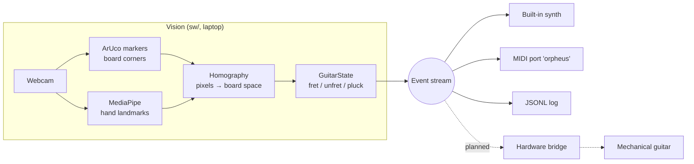
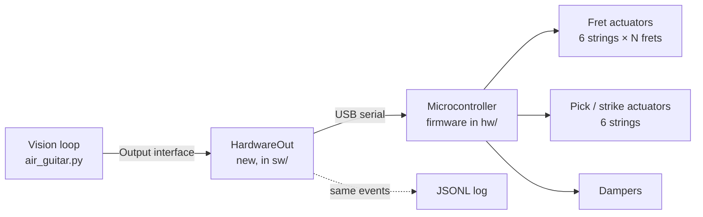

# Orpheus — Software Design Doc

Status: **Superseded by `docs/system-design.md`** (2026-10-26) · Last updated 2026-09-28 · Owner: Carlos Rojas

## 1. Summary

Orpheus turns hand movements into guitar playing. A webcam watches a player "play" a hand-held board shaped like a guitar neck. Software turns the video into a stream of guitar events: which string is fretted where, and when each string is plucked. Today that stream drives a software synth and MIDI. In the full project the same stream drives a mechanical guitar that frets and plucks real strings.

This doc covers:

- how the current software works (sections 2–6)
- what it can and can't do yet (section 7)
- how we plan to connect it to the mechanical guitar (sections 8–11)

The main design choice is that **the event stream is the contract**. Vision produces events and knows nothing about sound or hardware. Anything that consumes events (synth, MIDI, log file, mechanical guitar) knows nothing about cameras. Each side can be built, tested and replaced without touching the other.

## 2. Goals and non-goals

**Goals**

- Play recognisable guitar parts (open chords, strums, simple melodies) with no instrument in hand.
- Produce a hardware-agnostic event stream the mechanical guitar can consume in real time.
- Run on a laptop with one webcam, with no GPU and no training data needed to get started.
- Keep every stage testable offline: record events once, replay them into any consumer.

**Non-goals (for now)**

- Studio-grade timing. The single-camera pipeline adds roughly 60–100 ms of latency.
- Techniques beyond fret and pluck: bends, slides, hammer-ons, vibrato.
- Retraining hand-tracking models.

## 3. System overview



Everything left of the event stream exists and runs today. The dashed path is the integration work described in section 8.

## 4. Components

All code lives in `sw/` (Python 3.13).

| Module | Responsibility | Depends on |
| --- | --- | --- |
| `air_guitar.py` | Main loop: capture → track → map → events → outputs; on-screen overlay; CLI flags | everything below |
| `board.py` | Detects ArUco markers 0–3 and builds the pixel ↔ board-space transform. Smooths corners, holds the last transform through short dropouts, falls back to a fixed rectangle | OpenCV |
| `guitar.py` | Pure logic with no I/O. Fingertip positions in board space become fret/unfret/pluck events. Holds the board layout constants and tuning | nothing |
| `synth.py` | `Synth` (Karplus-Strong plucked string, per-string voices) and `MidiOut` (virtual MIDI port). Both implement `pluck(string, note, velocity)` and `mute(string)` | sounddevice, mido |
| `hand_shapes.py` | Earlier gesture demo. Also provides shared landmark constants and drawing helpers | MediaPipe, OpenCV |
| `gen_markers.py` | Writes `markers.png`, the printable marker sheet | OpenCV |

**Stack:** OpenCV (camera, drawing, ArUco, homography), MediaPipe Tasks API `<1.0` (pinned because 1.0.x crashes on macOS/Metal), NumPy, sounddevice, mido + python-rtmidi.

**Output interface.** Every consumer implements the same two methods:

```python
class Output:
    def pluck(self, string: int, midi_note: int, velocity: float): ...
    def mute(self, string: int): ...
    def close(self): ...
```

The main loop calls `pluck` on every pluck event and `mute` on every unfret event. The hardware bridge will be one more implementation of this interface (section 8).

## 5. How a frame is processed

The loop runs at about 25–30 fps on an M1 Pro. Each frame goes through five steps.

1. **Capture.** Grab a webcam frame, mirror it, convert it to RGB.
2. **Hand landmarks.** MediaPipe `HandLandmarker` in VIDEO mode returns 21 keypoints per hand, with a Left/Right label. Left frets and Right picks; `--lefty` or the `l` key swaps them.
3. **Board space.** `board.py` finds the four corner markers and maps them to the unit square. Any pixel becomes `(u, v)`:
   - `u` runs from 0 at the nut to 1 at the bridge end.
   - `v` runs from 0 at the top string to 1 at the bottom string.

   Because everything downstream uses board space, the player can move and tilt the board freely.
4. **Guitar logic (`guitar.py`).**
   - Layout: a fret zone at `u < 0.65` with 5 equal frets, and a strum zone at `u ≥ 0.65`. The six string lines sit at `v = (i + 0.5) / 6`.
   - Fretting: index to pinky tips inside the fret zone map to `(string, fret)` cells. On each string the highest fret held wins. A change must persist 2 frames (debounce) before it becomes a `fret` or `unfret` event.
   - Picking: the index tip's previous and current `v` are compared. Every string line crossed in between produces a `pluck`, in crossing order. Direction is the sign of the move. Velocity is sweep speed in board-heights per second, capped at 1.0 (floor 0.15).
5. **Output.** Each event goes to every enabled output, is printed to the console, and is optionally appended to a JSONL log.

## 6. Event contract (v0)

This is the interface between vision and everything downstream: one JSON object per event, one per line in logs.

```json
{"kind": "fret",   "string": 1, "fret": 3, "t": 1758400000.12}
{"kind": "pluck",  "string": 1, "fret": 3, "note": 48, "direction": 1, "velocity": 0.7, "t": 1758400000.31}
{"kind": "unfret", "string": 1, "fret": 0, "t": 1758400001.02}
```

| Field | Type | Meaning |
| --- | --- | --- |
| `kind` | `fret` \| `unfret` \| `pluck` | Event type |
| `string` | int 0–5 | 0 = low E (top of board), 5 = high E |
| `fret` | int 0–5 | Fret held on that string (0 = open) |
| `note` | int | MIDI note sounded (pluck only). Standard tuning, open notes `[40, 45, 50, 55, 59, 64]` |
| `direction` | +1 / −1 | Down-strum / up-strum (pluck only) |
| `velocity` | float 0.15–1.0 | Pluck strength (pluck only) |
| `t` | float | Unix time in seconds when the frame was processed |

Semantics:

- The mechanical side should treat `fret` as "hold this string at this fret until told otherwise". `pluck` means "strike now".
- `unfret` means "release and damp".
- A `fret` event with a new fret number on a string that is already fretted means "move to this fret". There is no separate unfret in between.

## 7. Current capabilities and limitations

**Works today**

- Single-note melodies from E2 to A4 (open plus frets 1–5 on 6 strings).
- Open chords with up to 4 fretted notes, one finger per string: C, G, D, A, E, Am, Em, Dm.
- Down/up strums, partial strums across a subset of strings, and speed-to-velocity.
- Output to the built-in synth, to MIDI (any DAW instrument), and to a JSONL log.
- Lifting a fretting finger damps that string. Notes stop after a 2 s ring or a re-pluck, so MIDI notes no longer hang.

**Known limitations**

| Limitation | Cause | Planned fix |
| --- | --- | --- |
| Hovering fingers count as pressed | A single camera has no reliable depth | Low side camera, then capacitive/copper touch strips on the board |
| ~60–100 ms latency | Camera exposure and capture, inference, audio buffer | 60 fps camera, smaller audio block, wrist IMU for strum timing |
| No barre chords | One fingertip maps to one cell | Finger-segment coverage, or a chord-shape classifier |
| Only 5 equally spaced frets | Hand-held board size | Real fret spacing via `fret_u()`; more frets if the board allows |
| Index-finger picking only | One picking point tracked | Track thumb and all tips in the strum zone |
| Hand roles can swap | Relies on MediaPipe's Left/Right label | Assign roles by position on the board |
| Board lost when a hand covers a corner | Needs all 4 markers | Extra edge markers plus `cv2.findHomography` over the visible ones |

## 8. Integration plan: mechanical guitar

> **Assumptions.** Nothing about the mechanical design is in the repo yet (`hw/` is empty). This section fixes the software side of the interface and lists what we need from hardware. The actuator choice (solenoids, servos, etc.) only affects the firmware behind the bridge.

### 8.1 Architecture



- **`HardwareOut`**: a new class in `sw/` that implements the same `pluck` / `mute` interface (plus fret moves). It turns events into serial messages. The vision loop doesn't change beyond registering one more output (`--hw /dev/tty…`).
- **Microcontroller firmware** (in `hw/`) owns all timing-critical work: actuator sequencing, fret-before-pluck ordering, current limits and safety.
- **Transport: USB serial** is recommended over MIDI for the hardware link. It's simple on any MCU, easy to extend with fret and damp commands, and gives us acks and status back. We keep MIDI for audio monitoring.

### 8.2 Wire protocol (proposal)

Use compact, line-based ASCII messages. They're easy to debug with a serial monitor, and at 115200 baud a message takes well under 1 ms.

| Host → MCU | Meaning |
| --- | --- |
| `F <string> <fret>` | Hold string at fret (0 = release) |
| `P <string> <velocity 0–127> <dir ±1>` | Strike string |
| `M <string>` | Damp string |
| `X` | All off: release, damp, de-energise everything |
| `H` | Heartbeat. The MCU runs `X` itself if it hears nothing for 500 ms |

| MCU → Host | Meaning |
| --- | --- |
| `OK <seq>` / `ERR <code>` | Acknowledgement (optional, for debugging) |
| `S <status bits>` | Periodic status: faults, temperature, busy actuators |

Ordering rule: when a pluck arrives for a string whose fret move is still in progress, the **MCU** delays the strike until the fret is seated. The host doesn't try to time this.

### 8.3 Latency budget (target: under 150 ms, gesture to sound)

| Stage | Today | Target |
| --- | --- | --- |
| Camera capture and exposure | ~30 ms | ~17 ms (60 fps) |
| MediaPipe inference | 15–25 ms | same |
| Event logic | <1 ms | same |
| Serial to MCU | — | <2 ms |
| Fret actuator seat | — | **unknown (hardware)** |
| Pick actuator strike | — | **unknown (hardware)** |

Fretting ahead of the pluck helps: fret events usually arrive well before the strum, so fret actuation is mostly hidden. The critical path is pluck detection plus pick actuation.

### 8.4 Safety

- A heartbeat watchdog on the MCU. If the host crashes, everything releases.
- `X` (all off) is sent on quit, on `Ctrl-C`, and when hands are lost for more than 1 s.
- The host rate-limits plucks per string (e.g. at most 20 Hz) so a jittery fingertip can't hammer an actuator.
- Firmware enforces actuator duty-cycle limits on its own, never trusting the host.

## 9. Milestones

| # | Milestone | Deliverable | Needs |
| --- | --- | --- | --- |
| M0 | Vision prototype | Current `sw/` (done) | — |
| M1 | Physical board | Printed markers on a neck-shaped board; tuned `NUM_FRETS`, `FRET_ZONE`, debounce | Cardboard or plank |
| M2 | Freeze event contract | Sections 6 and 8.2 agreed with hardware; versioned `v1` | Hardware team review |
| M3 | Replayer and simulator | `replay.py` plays a JSONL log at recorded timing into any output; `HardwareOut` in dry-run mode prints serial frames | — |
| M4 | Single-string rig | One string: one fret actuator plus one striker, driven from the replayer, then live | First hardware |
| M5 | Full six-string guitar, live | Vision → hardware end to end; latency measured | M4 |
| M6 | Accuracy pass | Side camera and/or touch strips for press-vs-hover; optional wrist IMU for strum timing | M5 findings |

M3 lets software and hardware move in parallel. The hardware side can develop against recorded logs without a camera, and the software side can test against a simulated device without hardware.

## 10. Testing

- **Unit:** `guitar.py` is pure, so feed it synthetic fingertip tracks and assert on events. Test `board.py` with synthetic marker images.
- **Replay:** recorded JSONL sessions are the regression suite, covering chords, fast strums and dropouts. They replay into the synth, MIDI or hardware.
- **Hardware-in-the-loop:** log host send times and MCU ack times to measure serial and actuator latency per event.
- **Live:** scripted sessions ("play Em, strum down 4×") scored against the expected event sequence.

## 11. Open questions for the hardware side

1. What actuates frets and strikes (solenoid, servo, other), and what are their seat and strike times?
2. How many frets per string will the mechanical guitar cover? The board currently has 5.
3. Can one string hold two frets at once, or does the MCU need a single target fret per string? The current contract sends one per string.
4. How is velocity realised: PWM duration, strike distance, or not at all?
5. Is there a physical damper, or does "release fret" count as damping?
6. Which MCU (Arduino, ESP32, Teensy…) and how is it powered? This decides serial versus a network link.
7. Should hand-held-board touch sensing (for press-vs-hover) run on the same MCU or a separate one?

## Appendix: running the prototype

```bash
cd sw
.venv/bin/python gen_markers.py            # print markers.png, tape to board corners
.venv/bin/python air_guitar.py             # synth on by default
.venv/bin/python air_guitar.py --midi --log events.jsonl
```

Keys: `s` skeleton, `l` swap hands, `q` quit. With no markers visible, a fixed rectangle in the middle of the frame acts as the board.
