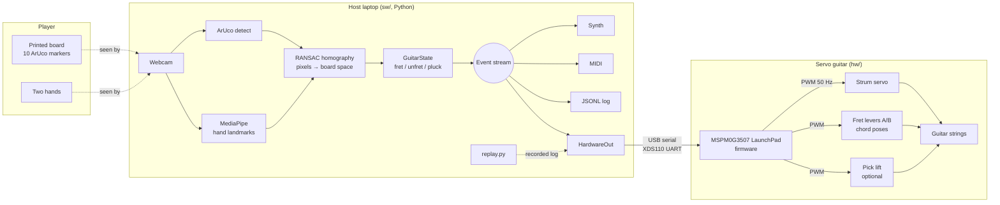
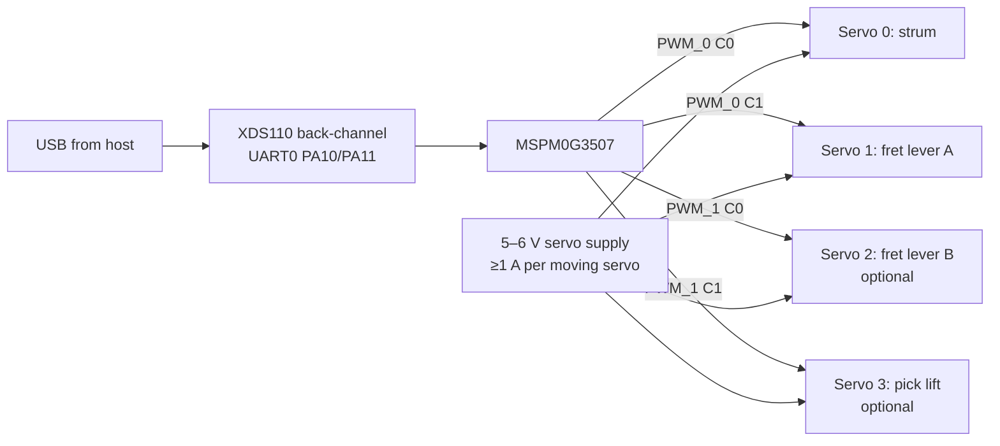

# Orpheus — System Design

Status: Draft v2 · Last updated 2026-10-26 · Owner: Carlos Rojas
v2: hardware scope switched to Kamsi Elele's chord-pose servo rig on the TI MSPM0G3507 (branch `air-guitar-poc-kamsi`).
Supersedes `docs/software-design.md` (2026-09-28). Vision details and the CV review notes stay in `docs/vision-status.md` and `docs/vision-brief.md`.

## 1. Summary

Orpheus turns hand movements into real guitar playing. A player holds a printed, neck-shaped board and plays it like a guitar. A webcam watches, and software turns the video into a stream of guitar events: which string is fretted at which fret, and when each string is plucked. Today that stream drives a software synth and MIDI. In the full system the same stream drives a **TI MSPM0G3507 LaunchPad** that moves a few **servos**: fret levers that press preset chord shapes, and a strum servo that sweeps a pick across the strings of a real guitar.

The hardware plays **chords and strums**, not single notes. The host reduces note-level events from the board to "which chord pose, then strum down/up" (§8). Single-note playing stays available on the synth and MIDI.

The main design rule is that **the event stream is the contract**:
- Vision produces events and knows nothing about sound or hardware.
- Consumers (synth, MIDI, log file, servo guitar) know nothing about cameras.

Each side can be built, tested and replaced on its own. Recorded event logs let the hardware be developed without a camera, and a simulated device lets the software be tested without hardware.

| Layer | Where | State |
| --- | --- | --- |
| Physical board (printed template, ArUco markers) | `sw/gen_board.py`, `sw/layout.py` | Built; first live sessions run |
| Vision pipeline (camera → events) | `sw/` | Working prototype |
| Audio outputs (synth, MIDI, JSONL log) | `sw/synth.py`, `--log` | Working |
| Host-to-hardware bridge (`HardwareOut`, replayer) | `sw/` (planned) | Designed here (§8) |
| Embedded controller + servo actuation (MSPM0, 2–4 servos) | `hw/` (planned); prototype firmware on Kamsi's branch (not yet pushed) | Designed here (§9); chord-pose mechanism still open |

## 2. Goals and non-goals

**Goals**
- Play recognisable guitar parts (open chords, strums, simple melodies) with no instrument in hand.
- Drive a real guitar from the same event stream in real time, with a small servo rig: chord-pose fretting plus one strum servo.
- Gesture-to-sound latency under 150 ms end to end.
- Run on a laptop with one webcam: no GPU, no training data needed to start.
- Every stage testable offline: synthetic frames for vision, recorded logs for hardware.
- Fail safe: if the host stops, the guitar releases every actuator within half a second.

**Non-goals (for now)**
- Studio-grade timing.
- Techniques beyond fret, pluck and damp (no bends, slides, hammer-ons, vibrato).
- Barre chords.
- Single-note melodies or per-string plucking **on the hardware** (the synth still plays them).
- Retraining hand-tracking models.

## 3. System overview



The host decides **what** to play: which chord pose, and when to strum which way. The microcontroller decides **how and exactly when** each servo moves: pose angles, waiting for the pose to settle before strumming, and the safety watchdog.

## 4. Physical board

The board is a 60 × 12 cm foam-board or cardboard strip with a printed template. `gen_board.py` generates the template as 3 US Letter pages (at true scale, with a 10 cm check bar on each) plus a matching `board_layout.json`. Both come from the same constants, so the print and the code can't disagree.

```
+--------------------------------------------------------------+
| [0]          [1]          [2]          [3]          [4]      |  marker strip
|--------------------------------------------------------------|
| NUT | 1 | 2 | 3 | 4 | 5 |▒dead▒|        STRUM zone         |  playing area
|--------------------------------------------------------------|  (board space u, v ∈ [0,1])
| [5]          [6]          [7]          [8]          [9]      |  marker strip
+--------------------------------------------------------------+
  u: 0 ............ 0.65 .. 0.72 ......................... 1.0
```

| Region | Board space | Behaviour |
| --- | --- | --- |
| Fret cells | `u < 0.65` (`FRET_ZONE`), 5 equal frets × 6 strings | Fretting-hand fingertips hold frets |
| Dead band | `0.65 ≤ u < 0.72` (`STRUM_START`) | Nothing. Stops strums that clip fret 5 from misfiring |
| Strum zone | `u ≥ 0.72` | Picking-hand index tip crossing a string line plucks it |

- **Markers:** 10 ArUco markers (`DICT_4X4_50`, IDs 0–9), 2.5 cm, five along each long edge. The layout stores each marker's 4 corners in cm.
- **Coordinates:** `u` runs along the neck from the nut (0) to the far end (1); `v` runs across it from the top/low-E string (0) to the bottom/high-E string (1). Six string lines sit at `v = (i + 0.5) / 6`.
- **Changing the layout** (`FRET_ZONE`, `NUM_FRETS`, board or marker size) means rerunning `gen_board.py` and reprinting. The dead band and `STRING_SLOP` are code-only and need no reprint.
- Build steps are in `sw/README.md`.

## 5. Vision pipeline (host)

Each frame goes through five steps. Measured at 25–30 fps on an M1 Pro. The newer M5 machine hasn't been measured yet; `--diag` prints fps on quit.

1. **Capture.** `cv2.VideoCapture` (`--camera N`). The frame is mirrored for display. The first ~2 s of failed reads are retried, because cameras often drop frames while starting up.
2. **Hand landmarks.** MediaPipe `HandLandmarker` (Tasks API, pinned `<1.0`, VIDEO mode, 2 hands, CPU). It returns 21 keypoints per hand plus a Left/Right label. By default the hand labelled Right frets and the one labelled Left picks; `--lefty` or the `l` key swaps them.
3. **Board space (`board.py`).**
   - ArUco detection runs on the **un-mirrored** image, because a mirrored marker decodes as nothing or as the wrong ID. The corners are then mapped into display coordinates.
   - Each visible marker contributes 4 (pixel ↔ cm) pairs. `cv2.findHomography` with RANSAC (0.5 cm threshold) fits pixels → cm over whichever markers are visible (at least 2), so a hand covering some markers doesn't lose the board. The fit is in cm because the board is much longer than it is wide.
   - The playing area's corners are projected back to pixels, smoothed (0.5 EMA) and mapped to the unit square.
   - If tracking is lost, the last transform is held for 15 frames, then a fixed on-screen rectangle takes over.
   - A `well_spread()` check (TODO) will reject fits from markers bunched at one end.
4. **Guitar logic (`guitar.py`, pure, no I/O).**
   - *Fretting:* index to pinky tips in the fret zone map to `(string, fret)` cells, within `STRING_SLOP` of a string line. The highest fret on a string wins. A change must persist 2 frames (`debounce`) to become a `fret` or `unfret` event.
   - *Picking:* compare the index tip's previous and current `v` in the strum zone. Every string line crossed is a `pluck`, in crossing order. Direction is the sign of the move. Velocity is sweep speed (board-heights/s ÷ 4), clamped to 0.15–1.0.
5. **Outputs.** Every event goes to each enabled output (`pluck` → `pluck()`, `unfret` → `mute()`), is printed, and is optionally appended to a JSONL log.

Diagnostics (`d` / `--diag`) show marker IDs, the fit's inlier count and reprojection error, marker size in pixels, and rolling tracking %. A summary prints on quit.

## 6. Event contract (v0)

One JSON object per event, one per line in logs. All values are plain JSON numbers.

```json
{"kind": "fret",   "string": 1, "fret": 3, "note": 0, "direction": 0, "velocity": 0, "t": 1793034221.53}
{"kind": "pluck",  "string": 1, "fret": 3, "note": 48, "direction": 1, "velocity": 0.7, "t": 1793034221.81}
{"kind": "unfret", "string": 1, "fret": 0, "note": 0, "direction": 0, "velocity": 0, "t": 1793034222.02}
```

| Field | Type | Meaning |
| --- | --- | --- |
| `kind` | `fret` \| `unfret` \| `pluck` | Event type |
| `string` | int 0–5 | 0 = low E (top of board), 5 = high E |
| `fret` | int 0–5 | Fret held on that string (0 = open) |
| `note` | int | MIDI note sounded (pluck only). Open strings `[40, 45, 50, 55, 59, 64]` |
| `direction` | +1 / −1 | Down / up stroke (pluck only) |
| `velocity` | float 0.15–1.0 | Pluck strength (pluck only) |
| `t` | float | Unix time (s) when the frame was processed |

Semantics for consumers:
- `fret`: hold this string at this fret until told otherwise. A new `fret` on an already-fretted string means "move", with no `unfret` in between.
- `unfret`: release and damp the string.
- `pluck`: strike now. `fret` is informational, since the consumer already knows the held fret.

v1 (to freeze at milestone M2) will add a `"v": 1` field and a per-session sequence number.

## 7. Host software structure

| Module | Responsibility |
| --- | --- |
| `air_guitar.py` | Main loop, overlay, diagnostics, CLI |
| `board.py` | Marker detection, RANSAC homography, hold/fallback, diagnostics |
| `layout.py` | Physical layout in cm; JSON load/save; legacy 4-marker layout |
| `guitar.py` | Pure event logic and layout constants |
| `synth.py` | `Synth` (Karplus-Strong) and `MidiOut` (virtual port `orpheus`, timed note-off) |
| `gen_board.py` / `gen_markers.py` | Printable board template / old 4-marker sheet |
| `hand_shapes.py` | Early gesture demo; shared landmark constants and drawing helpers |
| `test_board.py` | Synthetic-frame tests for tracking and event serialisation |

**Output interface.** Every consumer implements:

```python
class Output:
    def pluck(self, string: int, midi_note: int, velocity: float): ...
    def mute(self, string: int): ...
    def fret(self, string: int, fret: int): ...   # new in v1; no-op for Synth/MidiOut
    def close(self): ...
```

## 8. Host-to-hardware bridge

### 8.1 Two input modes, one event stream

The host can turn hands into events two ways. Both feed the same outputs.

| Mode | Fretting input | Origin | What it produces |
| --- | --- | --- | --- |
| **Board** | Fingertips on the printed board's fret cells | `sw/` (this branch) | Per-string `fret` / `unfret`, per-string `pluck` |
| **Sign** | Hand sign 1–7 picks a chord of the key | Kamsi's `air_guitar/` | One chord shape = a `fret` event per string, plus whole-chord strums |

Kamsi's chord table is already one fret per string (`G: [3, 2, 0, 0, 0, 3]`), so a sign-mode chord is exactly 6 board-mode `fret` events. Merging the two front-ends doesn't need a new event type. Kamsi's strum detector and position-based hand roles are planned to replace the equivalent parts of `guitar.py` / `air_guitar.py` (§12).

### 8.2 `HardwareOut` (planned, `sw/hardware.py`)

The servo rig can only fret a fixed set of chord poses and strum all strings at once. `HardwareOut` is the one place that reduces events to that.

- **Chord matching.** It keeps the current fret per string, as `GuitarState.held` already does. When it changes, it looks for a pose with that exact shape in the shared pose table (§9.4). Strings a pose leaves unplayed (`None`) are ignored in the comparison.
  - All strings open → the `open` pose.
  - No match → keep the last pose and count a "no pose" miss, shown in `--diag`.
  - A pose change is sent as `C<pose>` straight away, usually well before the strum arrives.
- **Strum grouping.** Plucks arriving within 60 ms of each other in the same direction collapse into one strum: `D<v>` or `U<v>`, with `v` = the group's highest velocity × 127. A lone single-string pluck still triggers a whole-chord strum. That's the accepted limitation of this scope.
- **Safety.** It sends a heartbeat `H` every 100 ms, and `R` (all to rest) on quit, on Ctrl-C, or when hands are lost for more than 1 s.
- **Rate limit.** At most 8 strums/s, to protect the strum servo.
- **Dry run.** `--hw-dry-run` prints the serial lines instead of sending them.
- **Status reader.** A reader thread prints firmware lines (`PONG`, errors).
- **Interface.** It implements `pluck`, `mute`, `fret` and `close` like every other output. It's enabled with `--hw /dev/tty.usbmodem…`.

### 8.3 `replay.py` (planned)

It reads a JSONL session and feeds it to any output at the recorded timing (`--speed 0.5` for slow motion). This is how the servo rig is brought up and regression-tested without a camera. Recorded sessions become the shared test suite for both input modes.

### 8.4 Why USB serial

The LaunchPad's XDS110 debugger exposes UART0 (PA10/PA11) as a USB serial port on the same cable used for flashing, so no extra hardware is needed. It runs at 115200 baud (well under 1 ms per command), is readable in any serial monitor, and reports back. MIDI stays for audio monitoring.

## 9. Embedded system and servo actuation (MSPM0, chord poses)

> **Status:** proposal, based on Kamsi's proof of concept. The README on `air-guitar-poc-kamsi` describes `firmware_mspm0/main.c` and `servo_console.py`, but they **aren't pushed yet**, so nothing below has been checked against real firmware. The chord-pose mechanism isn't designed yet.

### 9.1 Hardware



- **MCU:** TI LP-MSPM0G3507 LaunchPad, programmed with SysConfig + DriverLib in CCS.
- **PWM:** two timer instances (`PWM_0`, `PWM_1`) at about 1 MHz tick, 20000-count period (50 Hz), edge-aligned, 2 channels each. The firmware reads the real period at runtime, so pulse widths stay correct if the clock setup changes.
- **UART:** `UART_0`, 115200 8N1, with an RX interrupt.
- **Power:**
  - Servos run from a **separate 5–6 V supply**, never the LaunchPad's USB power.
  - Budget about 1 A per servo moving at the same time.
  - The supply's ground ties to a LaunchPad GND pin.
- **Signal level:** MSPM0 pins are 3.3 V. Most hobby servos accept that; if one jitters, add a 3.3 → 5 V level shifter.

### 9.2 Actuators

| Servo | Job | How |
| --- | --- | --- |
| 0: strum | Strums all strings | The horn carries a pick and rests on one side of the strings (`STRUM_SIDE_A_US`). Sweeping to the other side (`STRUM_SIDE_B_US`) strums. **Down vs up = which way it sweeps**, matching the event's direction |
| 1: fret lever A | Holds a chord shape | Each lever angle presses a preset shape: a bar, cam or comb pressing several strings at once. One lever with N angles gives N poses |
| 2: fret lever B (optional) | More chord shapes | A second lever multiplies the number of poses: pose = (angle A, angle B) |
| 3: pick lift (optional) | Repositions without strumming | Lifts the pick so it can return to the right side silently |

**Keeping strum direction in sync:** if two strums in a row go the same direction, the pick is on the wrong side for the second one. With a lift servo, the firmware lifts, returns and drops without sounding. Without one, it strums the other way instead, so the beat isn't lost. This is the behaviour Kamsi's README describes.

The old one-servo-per-fret-cell design (37 servos, 3 PCA9685 boards) is kept only as a **stretch goal**. It's the only way the hardware could play single notes.

### 9.3 Firmware behaviour

- **Pose table:** `CHORD_POSE[pose] = {lever A µs, lever B µs}`. Calibrated angles are compiled into the firmware for now, set by jogging with `S<ch>,<us>` from `servo_console.py`.
- **Ordering (proposed addition):** a strum that arrives while a pose change is still moving waits until the pose has settled, after a calibrated `POSE_SETTLE_MS` (about 80–150 ms for a lever). This keeps fret-before-strum on the MCU, where the timing is known.
- **Velocity:** hobby servos move at one speed, so strum strength only affects the synth's volume. On the rig, `D<v>`/`U<v>` could later choose between two sweep endpoints (lighter or deeper pick contact).
- **Watchdog (proposed addition):** no `H` and no other command for 500 ms → all servos to rest.
- **Polarity check:** if the first servo slams to an end and buzzes, flip `CC_SETS_LOW_TIME` in `main.c` (per Kamsi's README).

### 9.4 Wire protocol (v1, shared)

This is Kamsi's protocol, with two proposed changes marked † that need Kamsi's agreement:
- a heartbeat;
- making `C` refer to a **fixed pose table** instead of "chord *i* of the current key/mode".

The second change matters because today index 0 means G in G major but D in D major, so the firmware would have to know the host's key and mode.

| Host → MCU | Meaning |
| --- | --- |
| `C<pose>` † | Move fret levers to pose `<pose>`, an index into the shared pose table below |
| `D<v>` / `U<v>` | Strum down / up, strength 0–127 |
| `S<ch>,<us>` | Raw pulse on servo channel (clamped 500–2500 µs), for calibration |
| `R` | All servos to rest |
| `P` | Ping; firmware answers `PONG` |
| `H` † | Heartbeat; with nothing received for 500 ms the firmware runs `R` |

**Shared pose table** (†). One file, `poses.json`, read by the host and copied into the firmware's `CHORD_POSE` order:

```json
["open", "G", "C", "D", "Em", "Am"]
```

Each name refers to a fret shape in the host's chord table, e.g. `"G": [3, 2, 0, 0, 0, 3]`. The firmware stores only the lever angles for each pose. The list above is a placeholder, since the real one depends on which shapes the lever mechanism can press (§14). Sign mode maps a key's chord 1–7 to these names and sends the matching index; chords the rig can't press play on the synth only.

### 9.5 Safety

- Watchdog plus heartbeat (†): a host crash or unplugged cable sends everything to rest.
- `R` on quit, on Ctrl-C, and when hands are lost for more than 1 s.
- The firmware clamps pulse widths to 500–2500 µs and enforces a minimum time between strums, without relying on the host.
- A physical switch on the servo supply as the e-stop.
- Power-on state: all servos at rest.

## 10. Latency budget (target under 150 ms, gesture to string)

| Stage | Estimate | Notes |
| --- | --- | --- |
| Camera exposure + capture | ~17–30 ms | 60 fps request at 640×480 (Kamsi's settings) vs ~30 ms at the default |
| MediaPipe inference | 15–25 ms | M1 Pro estimate; M5 not yet measured |
| Event logic + strum grouping | < 2 ms | Grouping waits for the first pluck only; later plucks join the strum already sent |
| Serial to MCU | < 1 ms | |
| PWM frame wait | 0–20 ms | 50 Hz servo update |
| Strum servo sweep | ~40–60 ms | Depends on the sweep angle and the servo |
| **Strum total** | **~75–140 ms** | Kamsi's README estimates 70–120 ms motion → strike |
| Pose change | ~80–150 ms | Usually hidden: chord changes come before the strum; the MCU waits only if the pose hasn't settled |

Nothing here has been measured. A slow-motion phone video of the hand and the strum servo together gives the real figure at milestone M4.

## 11. Testing

| Level | What | How |
| --- | --- | --- |
| Unit, vision | Board tracking with full, partial and mirrored marker views; legacy layout; event serialisation | `sw/test_board.py` (5/6 pass; `well_spread` TODO) |
| Unit, gestures | Strum detection, sign reading, keys and voicings | Kamsi's `air_guitar/test_logic.py` (13/13 pass) |
| Unit, bridge | Chord matching, strum grouping, rate limit, heartbeat | Planned `sw/test_hardware.py`: recorded events in, expected serial lines out |
| Protocol | Events → serial lines | `HardwareOut --hw-dry-run` against recorded logs |
| Firmware | Parser, pose table, watchdog, strum-direction sync | `servo_console.py` scripts against the LaunchPad |
| Hardware-in-the-loop | Pose settle time, strum timing, ordering | `replay.py` into the rig; slow-motion video |
| End to end | Scripted songs in both modes | "G C D Em, 4 down-strums each", scored against expected events and audio |

## 12. Current status and known limitations

**Working:** board tracking that survives partial occlusion; per-string fret and pluck events with a dead band; synth, MIDI and JSONL outputs; diagnostics. On Kamsi's branch: sign-mode chords, a tested strum detector, and the MSPM0 path described in its README.

| Limitation | Cause | Planned fix |
| --- | --- | --- |
| Hardware plays only the chord poses the levers can press, always strumming all strings | Scope choice: 2–4 servos | Accepted for this semester; per-cell fretting is the stretch goal |
| Board shapes that match no pose don't change the hardware chord | Fixed pose table | `--diag` "no pose" count; add poses mechanically if often missed |
| Hovering fingers count as pressed (board mode) | One camera, no reliable depth | Sign mode avoids it; side camera or touch strips for board mode |
| Hand roles can swap (board mode) | Relies on MediaPipe's Left/Right label | Adopt Kamsi's position-based role assignment |
| Strum detection is simpler than Kamsi's | No speed threshold or refractory period | Adopt `StrumDetector` ideas: hand-size-normalised speed, min speed, refractory period |
| Fit trusted from markers bunched at one end | `well_spread()` not written | Implement and tune |
| Firmware not in the repo | Not pushed with Kamsi's branch | Ask Kamsi to push `firmware_mspm0/` and `servo_console.py` |

## 13. Milestones

| # | Milestone | Deliverable | State |
| --- | --- | --- | --- |
| M0 | Vision prototypes | Board mode (`sw/`) and sign mode (`air_guitar/`) | Done |
| M1 | Physical board | Printed 10-marker board, diagnostics, live sessions | In progress |
| M2 | Freeze contract | Event v1 (§6), wire protocol and `poses.json` (§9.4) agreed with Kamsi | Next |
| M3 | Bridge + replay | `HardwareOut` (chord matching, strum grouping, heartbeat), `--hw-dry-run`, `replay.py`, tests | Next, parallel with M4 |
| M4 | Strum-only rig | MSPM0 + strum servo driven from replay, then live; strum latency measured | Needs firmware pushed |
| M5 | Chord-pose rig | Fret lever(s) with the first poses (e.g. open, G, C, D), both input modes live | After M4 |
| M6 | Merge front-ends | One app with board and sign modes, shared strum detector and hand-role logic | After M5 |

## 14. Open questions

1. **Lever mechanism:** what presses a chord shape (a bar, cam or comb), and how many poses can one or two levers reach?
2. **Which chords get poses first?** G, C, D, Em cover the default progression in Kamsi's app.
3. **Pick lift:** needed, or is reversing the strum when out of sync good enough?
4. **Pose settle time and strum sweep time** of the chosen servos.
5. Is Kamsi OK with the two protocol changes (fixed pose table, heartbeat)?
6. **Repo layout:** keep `air_guitar/` and `sw/` side by side until M6, or merge sooner?
7. **Where the firmware lives:** `hw/firmware_mspm0/` in this repo, or `air_guitar/firmware_mspm0/` as Kamsi's README has it?

## Appendix: repo layout and running

```
orpheus/
  README.md
  docs/   system-design.md (this) · vision-status.md · vision-brief.md · software-design.md (old)
  sw/     board-mode vision + audio prototype (Python) — see sw/README.md
  hw/     firmware + hardware (planned; MSPM0 firmware currently on Kamsi's branch)
```

```bash
cd sw
.venv/bin/python gen_board.py                               # board.pdf + board_layout.json
.venv/bin/python air_guitar.py --diag --log session1.jsonl  # play; q to quit
.venv/bin/python test_board.py                              # synthetic tests
```
