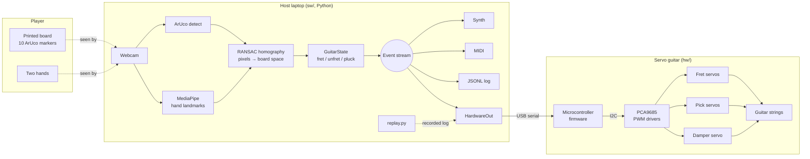
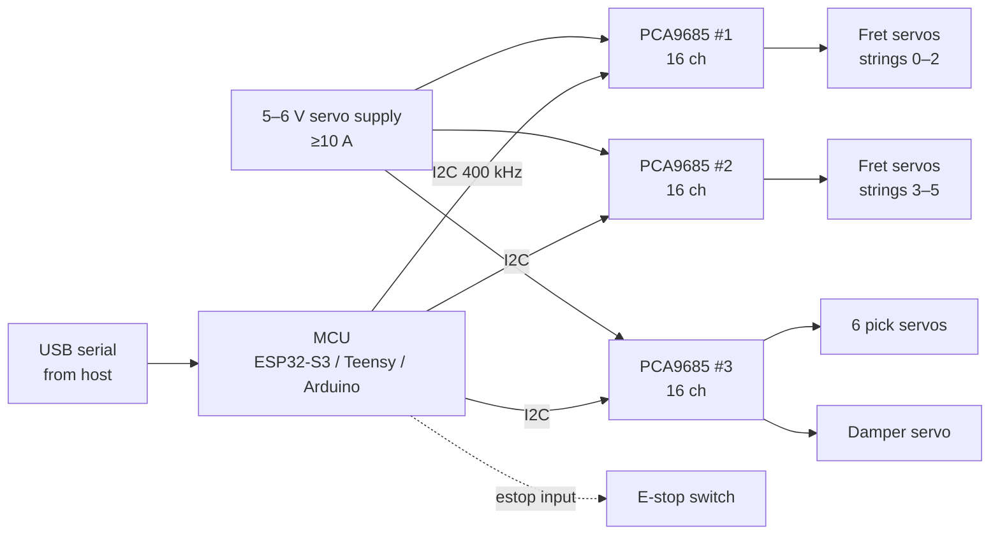
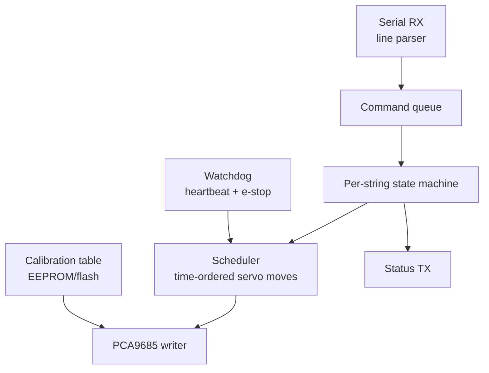

# Orpheus — System Design

Status: Draft v1 · Last updated 2026-10-26 · Owner: Carlos Rojas
Supersedes `docs/software-design.md` (2026-09-28). Vision details and the CV review notes stay in `docs/vision-status.md` and `docs/vision-brief.md`.

## 1. Summary

Orpheus turns hand movements into real guitar playing. A player holds a printed, neck-shaped board and plays it like a guitar. A webcam watches, and software turns the video into a stream of guitar events: which string is fretted at which fret, and when each string is plucked. Today that stream drives a software synth and MIDI. In the full system the same stream drives a microcontroller that moves **servos** to fret and pluck the strings of a real guitar.

The main design rule is that **the event stream is the contract**:
- Vision produces events and knows nothing about sound or hardware.
- Consumers (synth, MIDI, log file, servo guitar) know nothing about cameras.

Each side can be built, tested and replaced on its own. Recorded event logs let the hardware be developed without a camera, and a simulated device lets the software be tested without hardware.

| Layer | Where | State |
| --- | --- | --- |
| Physical board (printed template, ArUco markers) | `sw/gen_board.py`, `sw/layout.py` | Built; first live sessions run |
| Vision pipeline (camera → events) | `sw/` | Working prototype |
| Audio outputs (synth, MIDI, JSONL log) | `sw/synth.py`, `--log` | Working |
| Host-to-hardware bridge (`HardwareOut`, replayer) | `sw/` (planned) | Designed here (§8) |
| Embedded controller + servo actuation | `hw/` (planned) | Designed here (§9); mechanical design still open |

## 2. Goals and non-goals

**Goals**
- Play recognisable guitar parts (open chords, strums, simple melodies) with no instrument in hand.
- Drive a real guitar through servos from the same event stream, in real time.
- Gesture-to-sound latency under 150 ms end to end.
- Run on a laptop with one webcam: no GPU, no training data needed to start.
- Every stage testable offline: synthetic frames for vision, recorded logs for hardware.
- Fail safe: if the host stops, the guitar releases every actuator within half a second.

**Non-goals (for now)**
- Studio-grade timing.
- Techniques beyond fret, pluck and damp (no bends, slides, hammer-ons, vibrato).
- Barre chords.
- Retraining hand-tracking models.

## 3. System overview



The host decides **what** to play. The microcontroller decides **when exactly** each servo moves: it handles fret-before-pluck ordering, servo timing, current limits and the safety watchdog.

## 4. Physical board

The board is a 60 × 12 cm foam-board or cardboard strip with a printed template. `gen_board.py` generates the template as 3 US Letter pages (at true scale, with a 10 cm check bar on each) plus a matching `board_layout.json`. Both come from the same constants, so the print and the code can't disagree.

```
+--------------------------------------------------------------+
| [0]          [1]          [2]          [3]          [4]      |  marker strip
|--------------------------------------------------------------|
| NUT | 1 | 2 | 3 | 4 | 5 |▒dead▒|        STRUM zone         |  playing area
|--------------------------------------------------------------|  (board space u, v ∈ [0,1])
| [5]          [6]          [7]          [8]          [9]      |  marker strip
+--------------------------------------------------------------+
  u: 0 ............ 0.65 .. 0.72 ......................... 1.0
```

| Region | Board space | Behaviour |
| --- | --- | --- |
| Fret cells | `u < 0.65` (`FRET_ZONE`), 5 equal frets × 6 strings | Fretting-hand fingertips hold frets |
| Dead band | `0.65 ≤ u < 0.72` (`STRUM_START`) | Nothing. Stops strums that clip fret 5 from misfiring |
| Strum zone | `u ≥ 0.72` | Picking-hand index tip crossing a string line plucks it |

- **Markers:** 10 ArUco markers (`DICT_4X4_50`, IDs 0–9), 2.5 cm, five along each long edge. The layout stores each marker's 4 corners in cm.
- **Coordinates:** `u` runs along the neck from the nut (0) to the far end (1); `v` runs across it from the top/low-E string (0) to the bottom/high-E string (1). Six string lines sit at `v = (i + 0.5) / 6`.
- **Changing the layout** (`FRET_ZONE`, `NUM_FRETS`, board or marker size) means rerunning `gen_board.py` and reprinting. The dead band and `STRING_SLOP` are code-only and need no reprint.
- Build steps are in `sw/README.md`.

## 5. Vision pipeline (host)

Each frame goes through five steps. Measured at 25–30 fps on an M1 Pro. The newer M5 machine hasn't been measured yet; `--diag` prints fps on quit.

1. **Capture.** `cv2.VideoCapture` (`--camera N`). The frame is mirrored for display. The first ~2 s of failed reads are retried, because cameras often drop frames while starting up.
2. **Hand landmarks.** MediaPipe `HandLandmarker` (Tasks API, pinned `<1.0`, VIDEO mode, 2 hands, CPU). It returns 21 keypoints per hand plus a Left/Right label. By default the hand labelled Right frets and the one labelled Left picks; `--lefty` or the `l` key swaps them.
3. **Board space (`board.py`).**
   - ArUco detection runs on the **un-mirrored** image, because a mirrored marker decodes as nothing or as the wrong ID. The corners are then mapped into display coordinates.
   - Each visible marker contributes 4 (pixel ↔ cm) pairs. `cv2.findHomography` with RANSAC (0.5 cm threshold) fits pixels → cm over whichever markers are visible (at least 2), so a hand covering some markers doesn't lose the board. The fit is in cm because the board is much longer than it is wide.
   - The playing area's corners are projected back to pixels, smoothed (0.5 EMA) and mapped to the unit square.
   - If tracking is lost, the last transform is held for 15 frames, then a fixed on-screen rectangle takes over.
   - A `well_spread()` check (TODO) will reject fits from markers bunched at one end.
4. **Guitar logic (`guitar.py`, pure, no I/O).**
   - *Fretting:* index to pinky tips in the fret zone map to `(string, fret)` cells, within `STRING_SLOP` of a string line. The highest fret on a string wins. A change must persist 2 frames (`debounce`) to become a `fret` or `unfret` event.
   - *Picking:* compare the index tip's previous and current `v` in the strum zone. Every string line crossed is a `pluck`, in crossing order. Direction is the sign of the move. Velocity is sweep speed (board-heights/s ÷ 4), clamped to 0.15–1.0.
5. **Outputs.** Every event goes to each enabled output (`pluck` → `pluck()`, `unfret` → `mute()`), is printed, and is optionally appended to a JSONL log.

Diagnostics (`d` / `--diag`) show marker IDs, the fit's inlier count and reprojection error, marker size in pixels, and rolling tracking %. A summary prints on quit.

## 6. Event contract (v0)

One JSON object per event, one per line in logs. All values are plain JSON numbers.

```json
{"kind": "fret",   "string": 1, "fret": 3, "note": 0, "direction": 0, "velocity": 0, "t": 1793034221.53}
{"kind": "pluck",  "string": 1, "fret": 3, "note": 48, "direction": 1, "velocity": 0.7, "t": 1793034221.81}
{"kind": "unfret", "string": 1, "fret": 0, "note": 0, "direction": 0, "velocity": 0, "t": 1793034222.02}
```

| Field | Type | Meaning |
| --- | --- | --- |
| `kind` | `fret` \| `unfret` \| `pluck` | Event type |
| `string` | int 0–5 | 0 = low E (top of board), 5 = high E |
| `fret` | int 0–5 | Fret held on that string (0 = open) |
| `note` | int | MIDI note sounded (pluck only). Open strings `[40, 45, 50, 55, 59, 64]` |
| `direction` | +1 / −1 | Down / up stroke (pluck only) |
| `velocity` | float 0.15–1.0 | Pluck strength (pluck only) |
| `t` | float | Unix time (s) when the frame was processed |

Semantics for consumers:
- `fret`: hold this string at this fret until told otherwise. A new `fret` on an already-fretted string means "move", with no `unfret` in between.
- `unfret`: release and damp the string.
- `pluck`: strike now. `fret` is informational, since the consumer already knows the held fret.

v1 (to freeze at milestone M2) will add a `"v": 1` field and a per-session sequence number.

## 7. Host software structure

| Module | Responsibility |
| --- | --- |
| `air_guitar.py` | Main loop, overlay, diagnostics, CLI |
| `board.py` | Marker detection, RANSAC homography, hold/fallback, diagnostics |
| `layout.py` | Physical layout in cm; JSON load/save; legacy 4-marker layout |
| `guitar.py` | Pure event logic and layout constants |
| `synth.py` | `Synth` (Karplus-Strong) and `MidiOut` (virtual port `orpheus`, timed note-off) |
| `gen_board.py` / `gen_markers.py` | Printable board template / old 4-marker sheet |
| `hand_shapes.py` | Early gesture demo; shared landmark constants and drawing helpers |
| `test_board.py` | Synthetic-frame tests for tracking and event serialisation |

**Output interface.** Every consumer implements:

```python
class Output:
    def pluck(self, string: int, midi_note: int, velocity: float): ...
    def mute(self, string: int): ...
    def fret(self, string: int, fret: int): ...   # new in v1; no-op for Synth/MidiOut
    def close(self): ...
```

## 8. Host-to-hardware bridge

### 8.1 `HardwareOut` (planned, `sw/hardware.py`)

- It's one more `Output`, enabled with `--hw /dev/tty.usbmodem…`. The vision loop doesn't change beyond also calling `fret()` on fret events.
- It turns events into serial lines (§9.4), sends a heartbeat every 100 ms, and sends `X` (all off) on quit, Ctrl-C, or hands lost for more than 1 s.
- It rate-limits plucks per string (at most 15 Hz) so a jittery fingertip can't hammer a servo.
- `--hw-dry-run` prints the serial lines instead of sending them, so the protocol can be tested with no device.
- A reader thread logs MCU status (`S…`) and errors, and timestamps acks for latency measurement.

### 8.2 `replay.py` (planned)

It reads a JSONL session and feeds it to any output at the recorded timing (`--speed 0.5` for slow motion). This is how the hardware is brought up and regression-tested without a camera. Recorded sessions (chords, fast strums, dropouts) become the shared test suite for both sides.

### 8.3 Why USB serial

A USB CDC serial link is trivial on every candidate MCU, under 1 ms per message at 115200 baud, readable in any serial monitor, and carries status back. MIDI stays for audio monitoring; it has no clean way to express "hold fret" or return faults. A network link (ESP32 Wi-Fi) adds jitter and is only worth it if the guitar can't be cabled.

## 9. Embedded system and servo actuation

> **Status:** proposal. `hw/` is empty and the mechanical design isn't fixed. Servo counts, timings and currents below are planning numbers from typical hobby servos (SG90/MG90S class); confirm them against the datasheets for the parts actually chosen.

### 9.1 Hardware architecture



- **MCU:** any board with USB serial and I2C. An ESP32-S3 or Teensy 4.x gives headroom; an Arduino Uno/Nano also works for this command rate.
- **PWM drivers:** PCA9685 16-channel boards on one I2C bus, so the MCU doesn't generate dozens of PWM signals itself. Three boards give 48 channels (37 used).
- **Power:** servos run from a **separate 5–6 V supply**, never the MCU's USB 5 V, with a common ground. Use bulk capacitance (≥1000 µF) on each driver's servo rail, and fuse the supply.

### 9.2 Actuator mapping

| Function | Actuators | Count | Mechanism |
| --- | --- | --- | --- |
| Fretting | One servo per (string, fret) cell | 6 × 5 = 30 | A servo horn or lever presses the string onto the fret and holds while fretted |
| Picking | One servo per string | 6 | The horn carries a pick and rests on one side of the string. Moving to the other side plucks it. **Down vs up stroke = which side it moves to**, matching the event's `direction` |
| Damping | One servo with a felt bar across all strings | 1 | Lowered briefly on `unfret` or `X`; optionally per string later |

One servo per fret cell is the simplest mapping: every fret change is a single, independent move with no carriage to slide. Two cheaper alternatives, if 30 servos is too many:
- one sliding fretter per string (6 actuators), which is much slower to change frets;
- fewer frets.

Solenoids are the usual alternative for fretting, since they're faster and simpler to hold. The protocol in §9.4 doesn't change if the team switches.

**Note selection:** on each string, the firmware lowers only the servo for the highest held fret, mirroring the host's "highest fret wins" rule. Releasing goes back to the rest angle.

### 9.3 Firmware design



**Per-string state:** `held_fret`, `fret_ready_at` (time the fret servo is seated), `pick_side` (A/B), and `last_pluck_at`.

Command handling:
- **`F s f`:** raise the previous fret servo and lower the new one, with `fret_ready_at = now + t_seat` (calibrated, ~40–60 ms). `f = 0` just raises.
- **`P s vel dir`:** if `now < fret_ready_at`, the strike is scheduled for `fret_ready_at`, so **fret-before-pluck ordering is enforced here, not on the host**. The pick servo moves to the side given by `dir`. If it's already on that side, it first returns without striking (a "reset" move); this is logged so the host side can tune strum detection.
- **`M s`:** release the fret servo and pulse the damper (or a per-string damper later).
- **Velocity:** hobby servos run at one speed, so v1 maps velocity only to whether a soft or hard pick travel endpoint is used. Real dynamics need a different mechanism and are a non-goal for v1.

**Servo model:** hobby servos have no position feedback. "Seated" and "struck" are therefore **time-based**, using per-servo calibrated move times. Standard servos update at the 50 Hz PWM frame, adding up to 20 ms. Digital servos at 200–333 Hz cut that, and are recommended for the pick servos.

**Calibration:** per channel, the rest angle, active angle and move time are stored in flash. They're set over serial (`C ch us` jogs a channel to a raw pulse width; `W` saves). This is needed because servo horns, mounting and string heights vary.

**Thermal and current limits:**
- A fret servo holding against string tension draws current continuously.
- At most one fret servo per string is ever lowered, so at most 6 hold at once. The firmware enforces that cap, and releases any fret held more than 10 s without a refresh.
- Pick servos get a minimum interval between strikes.

### 9.4 Wire protocol (v1 proposal)

ASCII, one command per line, `\n`-terminated, 115200 baud or more. An optional trailing `#seq` makes the MCU echo an ack for latency measurement.

| Host → MCU | Meaning |
| --- | --- |
| `F <string> <fret>` | Hold string at fret (0 = release) |
| `P <string> <velocity 0–127> <dir ±1>` | Strike string |
| `M <string>` | Release and damp string |
| `X` | All off: release all frets, park picks, lower damper |
| `H` | Heartbeat. With none for 500 ms, the MCU runs `X` itself |
| `C <channel> <pulse_us>` / `W` | Calibration jog / save calibration |
| `?` | Report firmware version and channel map |

| MCU → Host | Meaning |
| --- | --- |
| `OK <seq>` / `ERR <code> <seq>` | Ack, only when `#seq` was sent |
| `S <bits> <active_frets> <temp>` | Status at 5 Hz: faults, e-stop, active servos |

The host sends **intent**, never servo angles or timing. Everything mechanical lives in firmware, so changing servos or switching to solenoids never touches `sw/`.

### 9.5 Safety

- **Watchdog:** no heartbeat for 500 ms → `X`. A host crash or unplugged cable releases everything.
- **Physical e-stop** cuts servo power directly, not through firmware.
- **The firmware never trusts the host:** it enforces the strike-rate limits, the cap on active fret servos, and the hold timeout itself.
- **Power-on state:** all servos at rest, with the damper down.

## 10. Latency budget (target under 150 ms, gesture to string)

| Stage | Estimate | Notes |
| --- | --- | --- |
| Camera exposure + capture | ~30 ms | ~17 ms with a 60 fps camera |
| MediaPipe inference | 15–25 ms | M1 Pro estimate; M5 not yet measured |
| Board fit + event logic | < 2 ms | |
| Serial to MCU | < 1 ms | |
| PWM frame wait | 0–20 ms | 3–5 ms with digital servos at 200–333 Hz |
| Pick servo throw (~20°) | ~30–40 ms | SG90 class ≈ 0.1 s / 60°; faster servos help most here |
| **Pluck total** | **~80–120 ms** | |
| Fret seat | ~40–60 ms | Usually hidden: fret events arrive before the strum, and the MCU delays the pluck only if the fret isn't seated yet |

Nothing in this table has been measured yet. Measuring host send time against MCU ack times (§8.1) and a slow-motion phone video of a strike against the strum gives the real numbers at milestone M4.

## 11. Testing

| Level | What | How |
| --- | --- | --- |
| Unit, vision | Board tracking with full, partial and mirrored marker views; legacy layout; event serialisation | `sw/test_board.py`: the real template is warped into synthetic frames with known ground truth (5/6 pass; `well_spread` TODO) |
| Unit, logic | Fret debounce, string crossings, dead band | Synthetic fingertip tracks into `GuitarState` |
| Live, vision | Tracking %, marker size, fps, hand roles, jitter | `air_guitar.py --diag --log sessionN.jsonl`; quit summary |
| Protocol | Event → serial lines | `HardwareOut --hw-dry-run` against recorded logs |
| Firmware | Parser, scheduler, watchdog | Host-side unit tests of the parser/scheduler logic; serial monitor scripts |
| Hardware-in-the-loop | Strike and seat timing, ordering, rate limits | `replay.py` into one-string rig; ack timestamps; slow-motion video |
| End to end | Scripted songs | "Play Em, strum down 4×" scored against the expected events |

## 12. Current status and known limitations

**Working:** 10-marker board tracking that survives partial occlusion; fret and pluck events with a dead band; synth, MIDI and JSONL outputs; diagnostics.

| Limitation | Cause | Planned fix |
| --- | --- | --- |
| Hovering fingers count as pressed | One camera, no reliable depth | Low side camera; then touch strips on the board or a learned press/hover classifier (`docs/vision-status.md`) |
| Hand roles can swap | Relies on MediaPipe's Left/Right label | Assign roles by position on the board (nut side frets) |
| Fit trusted from markers bunched at one end | `well_spread()` not written | Implement and tune (`min_markers`, RANSAC threshold) |
| ~60–100 ms vision latency (estimated) | Camera, inference | 60 fps camera; crop to the board area |
| Index-finger picking only; no barre chords | One tracked point / one cell per fingertip | Track more tips; chord-shape classifier |
| No dynamics on the servo guitar | Hobby servos have fixed speed | Two-endpoint soft/hard stroke in v1; better mechanism later |

## 13. Milestones

| # | Milestone | Deliverable | State |
| --- | --- | --- | --- |
| M0 | Vision prototype | `sw/` webcam → events → synth | Done |
| M1 | Physical board | Printed 10-marker board, diagnostics, first live sessions | In progress |
| M2 | Freeze contract | Event v1 (§6) and wire protocol (§9.4) agreed with hardware | Next |
| M3 | Replayer + dry run | `replay.py`, `HardwareOut --hw-dry-run` | Next, parallel with M4 |
| M4 | One-string servo rig | 1 pick servo + 5 fret servos + firmware, driven from replay, then live; latency measured | Needs hardware |
| M5 | Six-string servo guitar, live | Vision → servo guitar end to end | After M4 |
| M6 | Accuracy pass | Press vs hover, hand-role fix, strum timing | After M5 findings |

## 14. Open questions for the hardware side

1. Servo models for fret and pick, with their real move times, stall currents and holding torque against string tension.
2. Is 30 fret servos (one per cell) acceptable for mounting, cost and power, or is a per-string slider preferred?
3. How many frets should the guitar cover? The board has 5; more frets means reprinting the board.
4. One damper bar, or per-string dampers?
5. MCU choice and how the servo supply is sized and fused.
6. Is the pick-side-swap stroke mechanically reliable on every string, or does each string need a return move?
7. Does board touch sensing (for press vs hover) share this MCU or get its own?

## Appendix: repo layout and running

```
orpheus/
  README.md
  docs/   system-design.md (this) · vision-status.md · vision-brief.md · software-design.md (old)
  sw/     vision + audio prototype (Python) — see sw/README.md
  hw/     firmware + hardware (planned)
```

```bash
cd sw
.venv/bin/python gen_board.py                               # board.pdf + board_layout.json
.venv/bin/python air_guitar.py --diag --log session1.jsonl  # play; q to quit
.venv/bin/python test_board.py                              # synthetic tests
```
