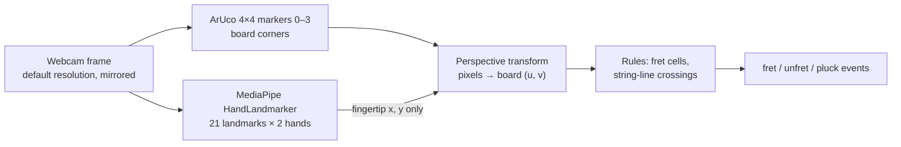

# Orpheus — Vision Brief for CV Review

Status: Prep for meeting with CV professor · 2026-09-28 · Full design: `docs/software-design.md`

## What we're building

A person holds a flat board shaped like a guitar neck and plays it as if it were a guitar. One webcam watches. Software works out which strings are fretted where and when strings are plucked, and turns that into events. The events drive a synth today and a mechanical guitar later. Everything below runs on a MacBook (M1 Pro, CPU only) at roughly 25–30 fps.

**What we want from this meeting:** advice on the two hard problems:

- telling a pressed finger from a hovering one with a single camera
- keeping the board and hands tracked reliably while someone is actually playing

## Pipeline

1. **Capture.** `cv2.VideoCapture` at the camera's default resolution and frame rate (we don't set either). The frame is mirrored horizontally *before* any detection so the view feels like a mirror.
2. **Hands (MediaPipe).** The Tasks API `HandLandmarker` returns 21 normalized landmarks per hand plus a Left/Right label. Details in the next section.
3. **Board (OpenCV ArUco).** We detect markers 0–3 from `DICT_4X4_50` with default detector parameters and take each marker's centre as a board corner. `cv2.getPerspectiveTransform` maps those four centres to the unit square:
   - `u` runs from 0 at the nut to 1 at the far end of the board.
   - `v` runs from 0 at the top string to 1 at the bottom string.

   Corners are smoothed with a 0.5 moving average (EMA). If a marker is missed, the last transform is held for 15 frames. After that, a fixed rectangle in the middle of the frame takes over.
4. **Rules.**
   - Fretting: the 4 fingertips (index to pinky) of the fretting hand are mapped into board space. The fret zone (`u < 0.65`) is a 6 × 5 grid of cells, and each tip in a cell holds that string at that fret. A change must persist for 2 frames before it counts.
   - Picking: the picking hand's index tip is tracked in the strum zone (`u ≥ 0.65`). Crossing one of the six string lines (`v = (i + 0.5) / 6`) between frames is a pluck. Sweep speed sets loudness.

## How we use MediaPipe exactly

| Setting | Value |
| --- | --- |
| Package | `mediapipe` 0.10.x, Tasks API (1.0.x crashes on this Mac, so it's pinned below 1.0) |
| Model | `hand_landmarker.task`, float16 bundle (palm detector + landmark regressor), 7.8 MB |
| Running mode | `VIDEO` with monotonically increasing ms timestamps, so it tracks between frames instead of re-detecting each one |
| `num_hands` | 2 |
| `min_hand_detection_confidence` | 0.6 |
| `min_hand_presence_confidence` | 0.6 |
| `min_tracking_confidence` | 0.5 |
| Delegate | CPU (TFLite/XNNPACK) |

**What we actually use from the output:**

- Only the normalized `x, y` of the fingertips, converted to pixels and then to board space: landmarks 8, 12, 16 and 20 for fretting, and 8 for picking.
- We ignore `z`, the other 16 joints, world landmarks and all confidence scores.
- The hand role comes from the handedness label: "Left" frets and "Right" picks. A key swaps them manually.

**What we don't do yet:** filter the landmarks over time (beyond the 2-frame debounce on fret changes), crop to a region of interest, record landmarks for offline analysis, or measure accuracy against ground truth.

## What goes wrong

| Problem | What we see | Our current guess at the cause |
| --- | --- | --- |
| **Press vs hover** | A finger just above the board frets a string, so chords come out wrong | One RGB camera, no depth. MediaPipe `z` is relative to the wrist and too noisy to threshold |
| **Fretting-hand occlusion** | Fretting-hand landmarks jitter or drop when the hand wraps the neck | From a front camera the fingertips are behind or edge-on to the board |
| **Marker dropout** | Covering any corner marker loses the board. It's held for 15 frames, then the fixed-rectangle fallback kicks in | We need all 4 markers; there's no partial fit |
| **Handedness flips** | Hand roles swap mid-play | The Left/Right label is unstable when a hand rotates or is partly hidden |
| **Fast strums** | A strum spans about 3 frames at 30 fps, and speed estimates are coarse | Frame rate, and possibly motion blur |
| **Latency** | Roughly 60–100 ms from gesture to sound (estimated, not measured) | Exposure and capture (~30 ms) + inference (15–25 ms) + audio buffer |
| **Jitter near cell boundaries** | A fingertip near a string or fret boundary flickers between cells | Landmark noise. The 2-frame debounce only partly hides it |

## Questions for the professor

Ranked by how much the answer would change what we build.

1. **Press vs hover with one camera.** Is there a reliable cue in monocular RGB, such as fingertip-to-board-edge geometry, joint angles, apparent tip size or shadow? Or should we go straight to:
   - a second view (a low side camera),
   - a depth camera (RealSense, OAK-D), or
   - touch sensors on the board, with vision only saying which finger?
2. **Camera placement.** Where would you put one camera to see both the fretting fingertips and the strum? Is two-camera triangulation worth the calibration effort at this scale?
3. **Board tracking under occlusion.** Is our approach right: more markers along the edges plus `cv2.findHomography` with RANSAC over whichever markers are visible? Or would you use ChArUco, a full-pose `solvePnP` model of the board, or tracking the board's own features?
4. **Temporal filtering.** For landmark jitter, would you use a One Euro filter, a Kalman filter on the tips, or something else? Where should it go: on pixels, in board space, or on the final cell decisions?
5. **Small learned models on top of the landmarks.** We think a small classifier on the 21 landmarks in board space could decide pressed vs hovering and recognise chord shapes. Is that reasonable? How much labelled data would it take, and how would you collect labels?
6. **Hand identity.** Is it better to assign fretting and picking hands by position relative to the board than by MediaPipe's handedness label?
7. **Speed and latency.** Are cropping to the board area, a lower input resolution, or a 60–120 fps camera worth it? Does motion blur on fast strums hurt the landmark model noticeably?
8. **Evaluation.** How should we measure accuracy? We have no ground truth yet. Options we're considering:
   - scripted sessions, where the on-screen prompt is the label
   - a key or foot pedal held while pressing
   - touch-sensor output labelling vision frames automatically

## Can show in the meeting

- A live demo: `cd sw && .venv/bin/python air_guitar.py`. Press `s` for the skeleton overlay. It works without the printed board; with no markers, a fixed on-screen rectangle is used.
- The code is small, about 850 lines of Python. `board.py` handles marker tracking and `guitar.py` holds the rules.
