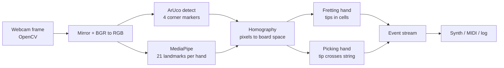

# Orpheus Vision — Status & Design

2026-09-21 · Live doc: https://claude.ai/code/artifact/1c74f6e9-7b51-41be-9aca-5a8b472bcebf

## What's in place

A working vision-only air guitar lives in `sw/`: webcam in, guitar events out, with a built-in synth so it makes sound today. All of it runs on a laptop with no hardware beyond the camera.

| File | Role | Status |
| --- | --- | --- |
| `air_guitar.py` | Main loop: camera → hands → board → events → sound, plus the on-screen overlay | Runs; tested live |
| `board.py` | Finds the four ArUco markers, builds the pixel → board-space transform; falls back to a fixed on-screen rectangle when no markers are visible | Runs; unit-tested with synthetic markers |
| `guitar.py` | Pure event logic: held fret per string (debounced), pluck on string-line crossing with direction and velocity | Unit-tested |
| `synth.py` | Karplus-Strong plucked-string synth (~3 ms per pluck) and optional virtual MIDI port `orpheus` | Audio verified through speakers |
| `gen_board.py` / `layout.py` | Printable true-scale board template (3 Letter pages) and the matching `board_layout.json`: 10 markers along the long edges, fret and string lines from `guitar.py`. `gen_markers.py` still writes the old 4-marker sheet | Runs; `test_board.py` covers tracking on synthetic frames |
| `hand_shapes.py` | First demo: fingertips → points → shapes, gesture names; also provides shared helpers | Runs |
| `models/hand_landmarker.task` | MediaPipe hand model, 7.8 MB, gitignored (curl line in README) | Present |

Stack: Python 3.13, OpenCV 5.0 (camera, drawing, ArUco, homography), MediaPipe 0.10.35 Tasks API (hand landmarks), NumPy, sounddevice, mido + python-rtmidi. MediaPipe 1.0.x is pinned out because it crashes in its Metal helper on this Mac.

Run it: `cd sw && .venv/bin/python air_guitar.py`. Flags: `--midi`, `--no-audio`, `--log events.jsonl`, `--lefty`, `--camera N`. Keys: `s` skeleton, `l` swap hands, `q` quit.

The event stream is the deliverable for the mechanical side. Each line of `--log` is one JSON object:

```
{"kind": "fret",  "string": 1, "fret": 3, "t": 1758400000.12}
{"kind": "pluck", "string": 1, "fret": 3, "note": 48, "direction": 1, "velocity": 0.7, "t": 1758400000.31}
{"kind": "unfret", "string": 1, "fret": 0, "t": 1758400001.02}
```

## How it works

Every frame goes through the same five steps; the whole loop runs at roughly 25–30 fps on the M1 Pro.



OpenCV handles everything that is pixels; MediaPipe handles only "where are the hands". They never talk to each other directly — the board transform is the bridge.

**1. Capture (OpenCV).** `cv2.VideoCapture` grabs a frame, `cv2.flip` mirrors it so it feels like a mirror, and it is converted to RGB for MediaPipe. Every drawn line, circle and label on screen is also OpenCV.

**2. Hand landmarks (MediaPipe).** `HandLandmarker` is a pretrained two-stage neural net: a palm detector finds hand boxes, then a landmark model regresses 21 keypoints per hand (wrist, then four joints per finger, thumb to pinky). It runs on CPU via TFLite/XNNPACK. `RunningMode.VIDEO` with a rising timestamp lets it track between frames instead of re-detecting, which is faster and smoother. It also labels each hand Left or Right, which is how the fretting and picking hands are told apart.

**3. Board space (OpenCV ArUco + homography).** `board.py` looks for the markers listed in `board_layout.json` (10 along the top and bottom edges by default; the original 4 corner markers if there's no layout file). Each visible marker's 4 corners are paired with their known positions in cm, and `cv2.findHomography` with RANSAC fits pixels → cm over whichever markers are visible (at least 2), so a hand covering some of them doesn't lose the board. The fit is in cm because the board is far longer than it is wide. The playing area's corners are projected back to pixels and map to the unit square, so any pixel becomes `(u, v)`: `u` runs 0 (nut) to 1 (bridge end) along the neck, `v` runs 0 (top string) to 1 (bottom string) across it. Detection runs on the un-mirrored frame, because a mirrored marker decodes as nothing or as the wrong ID. Corners are smoothed with a 0.5 EMA; if markers vanish, the last transform is held for 15 frames, then a fixed rectangle in the middle of the frame takes over so the app still works with no board at all.

**4. Guitar logic (`guitar.py`, no vision code).** Board space is divided into a fret zone (`u < 0.65`, 5 frets) and a strum zone (`u >= 0.65`). Six string lines sit at `v = (i + 0.5) / 6`.

- Fretting hand: index, middle, ring and pinky tips inside the fret zone map to `(string, fret)` cells. Per string, the highest fret held wins, like a real guitar. A change must persist 2 frames before it counts, which kills most flicker.
- Picking hand: the index tip's `v` is remembered from the last frame. Every string line between last `v` and this `v` is a pluck. Direction is the sign of the move; velocity is sweep speed in board-heights per second, capped at 1.0. A fast strum that crosses all six strings in one 33 ms frame still produces six plucks in the right order.

**5. Output.** A pluck plays `open_note[string] + held_fret` on the synth (Karplus-Strong: a noise burst through a short delay line, decaying each period) and optionally as a MIDI note-on. All events print to the console and, with `--log`, append to a JSON-lines file with a timestamp.

## What to do next, with what's here

The next step is a physical board; everything after that is tuning against real use. None of this needs new code before you start.

- [ ] **Print and build the board.** `python gen_board.py` writes `board.pdf` (3 Letter pages) and `board_layout.json`. Build steps are in `sw/README.md`. Run with `--diag` the first time: it shows which markers are seen, the fit error and the marker size in pixels.
- [ ] **Play with it and note what feels wrong.** Melodies with one finger should work out of the box. Try chords, fast strums, tilting the board, moving around the room. Use `--log` so there is a record to look at afterwards.
- [ ] **Tune the layout constants** in `guitar.py`: `NUM_FRETS` (5), `FRET_ZONE` (0.65), `STRING_SLOP` (0.6), and `debounce` (2 frames). Print real fret and string lines on the board that match these so your hands have a visual target.
- [ ] **Try a real instrument sound.** `--midi` opens a virtual port named `orpheus`; point GarageBand or any soft synth at it. This is also the first end-to-end latency test with a real sound source.
- [ ] **Camera placement.** Try the laptop camera, then a phone or webcam mounted low and to the side of the fretting hand. The side view separates pressed from hovering fingers far better than a front view.
- [ ] **Define the event contract with the mechanical side.** The JSON-lines format above is a proposal. Agree on it (or on MIDI) before either side builds against it, then write a tiny replayer that reads a log and feeds it to the guitar hardware at the recorded timestamps.

After that, the branches are optional and depend on what the board session shows:

| If this is the problem | Do this |
| --- | --- |
| Hovering fingers fret strings during chords | Low side camera first; if still bad, copper-tape or capacitive strips on the board so the board reports touches |
| Strum feels laggy | IMU (MPU-6050 or similar) on the picking wrist over serial, <5 ms; vision keeps fretting only |
| Hands swap or get lost | Assign hands by position on the board (nut side = fretting) instead of MediaPipe's Left/Right label |
| Markers drop out when a hand covers a corner | Done: 10 edge markers + RANSAC fit over the visible ones. If tracking is still lost, add markers or make them bigger |

## Current limitations

The two that matter are depth and latency; both are properties of a single camera, not bugs in the code. The rest are tuning or small rewrites.

| Limitation | Why | Effect you'll see | Fix path |
| --- | --- | --- | --- |
| No press-vs-hover detection | One camera has no depth; MediaPipe's `z` is relative and jittery | Fingers hovering over the neck fret strings they shouldn't; chords come out wrong | Side camera, or touch sensing on the board |
| Latency ~60–100 ms | Camera exposure + capture (~30 ms) + MediaPipe (~15–25 ms) + audio buffer (12 ms at 512 samples) | Strum and sound feel slightly disconnected; fine for visuals, noticeable for playing | Smaller audio block, 60 fps camera, or IMU for strum timing |
| 30 fps sampling | Webcam frame rate | A strum spans ~3 frames; velocity is coarse and very fast picking can skip a frame | Higher-fps camera; interpolate tip path |
| Hand roles by MediaPipe label | Fretting = "Left", picking = "Right"; label can flip when a hand turns or is partly occluded | Roles swap mid-play; `l` key swaps back | Assign by position relative to the board |
| Fretting hand occluded by the neck | From a front camera the fretting fingers are behind the board | Landmarks jitter or drop when the hand wraps the neck | Camera angle; hold the board so tips are visible |
| Marker dropouts | Needs at least 2 visible markers; whether 2 bunched at one end is enough is decided by `well_spread()` in `board.py` (not written yet) | Outline flips to the orange fixed region once fewer than 2 are visible for 15 frames | More or bigger markers; tune `min_markers` and the RANSAC threshold |
| One picking point | Only the index tip is tracked for strumming | Thumb plucks and fingerpicking are not detected | Track thumb + index, or all tips, in the strum zone |
| Uniform fret grid | 5 equal cells, not real logarithmic spacing | Doesn't match a real neck | Cosmetic; change `fret_u()` |
| No hammer-ons, bends, mutes, sustain control | Only fret/unfret/pluck events exist | Every sounding note is a fresh pluck; fret changes while ringing don't re-pitch | Add event kinds when the mechanical side can act on them |
| Lighting | ArUco needs decent contrast; MediaPipe degrades in dim or backlit scenes | Tracking loss near windows or in low light | Matte paper markers, even lighting |

Unknowns until the board exists: how reliable marker tracking is at the size you print, and whether the fixed fret zone width suits your hand span.

## Machine learning: what's there, what would help

The only ML in the system today is MediaPipe's pretrained hand model, and that should stay pretrained. Training is worth it for exactly one thing right now: a small classifier that decides *pressed vs. hovering* from the landmark geometry, and only if the side-camera and touch-sensor routes turn out to be unwelcome. Everything else is rule-based and should remain so until the rules demonstrably fail.

**Don't retrain MediaPipe.** It was trained on millions of hands and is far better than anything trainable from a few hours of your footage. Its output (21 points, normalized) is also the ideal input for any small model of your own, because it already removes lighting, skin tone, background and camera differences.

**Where a small trained model would beat rules:**

| Problem | Input | Label | Model | Why ML instead of rules |
| --- | --- | --- | --- | --- |
| Pressed vs. hovering | 21 landmarks of the fretting hand in board space, plus finger-segment lengths and angles | 0/1 per fingertip | Logistic regression or a 2-layer MLP, thousands of samples | Depth cues are subtle: apparent tip size, joint angles, tip-to-board-edge distance all vary together; hand-writing thresholds is fragile |
| Chord shape | Same landmarks | Chord name (E, Am, G…) | k-NN or a tiny MLP, ~100 samples per chord | Direct shape → chord skips per-string cell logic and is robust to hovering fingers |
| Strum intent | Last ~10 frames of picking-tip `(u, v)` | pluck / no pluck, direction | Small 1-D conv or GRU | Distinguishes a strum from repositioning the hand across strings; rules today count every crossing |
| Velocity calibration | Sweep speed, hand size | Perceived loudness (0–1) | Linear fit | Cheap; maps speed to how hard you meant it |

All of these are minutes to train on a laptop. The work is in labelling, not modelling.

**Start recording now, even before deciding.** Add a `--record` flag that writes per-frame landmarks (both hands, board space) with timestamps, alongside the event log. Three cheap ways to get labels:

1. Scripted sessions: on-screen prompt says "hold E chord", "strum down", "hover over fret 3"; the prompt is the label. This gives clean pressed/hover and chord data in a 20-minute session.
2. A foot pedal or spacebar held while actually pressing: the key state labels every frame.
3. Once the board has touch strips, the board's own touch output labels vision frames automatically; that pairing is the cleanest dataset and is the main reason to build the sensor board even if vision ends up doing the work.

**What not to bother with:** end-to-end video-to-notes models, pose estimation retraining, or anything needing a GPU. The pipeline decomposition (landmarks → board space → events) already makes each remaining problem small enough for a classical classifier, and small models are easy to debug when a note is wrong.
